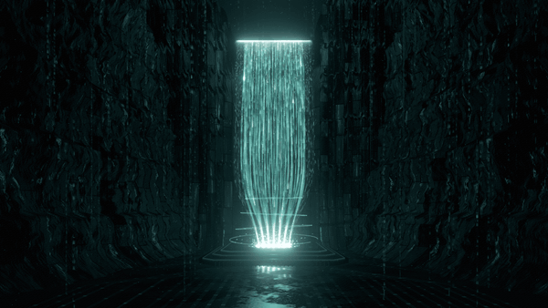

# Waterfall

A scroll experience built around a real-time waterfall of light. A hero with your words over the fall; a dive into it; a journey down through the machine it feeds; and an ending where the waterfall splits into three channels of light, each to a pedestal with its own glyph, and a card under each. The cards measure the page itself, live, in your visitor's browser.

Raw WebGL2, no dependencies, no build step. Every word, colour and motion setting is in one file, [`config.js`](config.js).

**See it live → [athanor.fluxora.build](https://athanor.fluxora.build)**, the piece it was made for.

## Quick start

```bash
git clone https://github.com/Fluxora-Build/waterfall.git
cd waterfall
npx serve .
```

(Or `npm run dev`, which runs the same.) Open the address it prints. There is nothing to install or build, but ES modules do not load from `file://`, so the folder has to be served (`npx serve`, `python3 -m http.server`, or any static host).

To make it yours, edit `config.js` and reload. To put it online, upload the folder as it is to any static host (Cloudflare Pages, Netlify, GitHub Pages, S3).

## What is in `config.js`

| Section | What it holds |
|---|---|
| `meta` | The page title, description, address and link-preview image. |
| `brand`, `nav` | The wordmark, the links in the middle and the action on the right. |
| `hero` | The eyebrow, the two-line headline (`*stars*` mark the accented words), the sentence under it, the two buttons and the screen-reader description of the scene. |
| `controls` | The four controls on the right. Hovering, focusing or tapping one changes what the machine does: take in, transform, single out, release. The behaviours are fixed; the words are yours. |
| `readout` | The small live panel under the controls (frames a second, frame time, bytes over the wire). |
| `ending` | The three items at the end: title, note, card icon (a 20 × 20 stroke SVG), the glyph over the pedestal (`'bolt'`, `'wave'`, `'feather'`, `'layers'`, `'prism'` or `'network'`) and the colour of its channel. Give an item a `measure` to make it a live reading, or a `value` and `unit` for your own words. |
| `footer`, `credit` | The section after the journey, and the small "Built with Waterfall" credit. Set `credit.show` to `false` to remove it. |
| `colours` | `light` grades the whole scene's hue and saturation: the scene was made in `#5fe9de` (the teal in the GIF above), and a grey takes the colour out. `background`, `ink`, `accent` and `onAccent` are the page's. |
| `fonts` | The sans and mono stacks. The defaults are the system's, so no fonts are downloaded. |
| `motion` | The journey's length, the dive's and the autopilot's durations, the idle walk through the controls, and the headline's decode. |

## Colours

Teal is the default: the scene exactly as it was lit. To change the colour, set `colours.light` and `colours.accent` in `config.js` to the same value. The presets:

| Preset | `light` and `accent` |
|---|---|
| Teal (default) | `#5fe9de` |
| Amber | `#ffb547` |
| Electric blue | `#4f8bff` |
| Violet | `#9d7bff` |
| White | `#e8f1ff` |

Any CSS colour works. The light turns the hue of the whole frame, so in any colour but teal the three channels at the end turn with it: the centre channel, warm amber in teal, takes the opposite hue. To keep the three distinct, set each item's `colour` in `ending.items`; the cards follow the channels.

## The three live readings

Nothing on the cards is written in by hand. Each says "measuring…" until its number has settled.

- **Fast:** the largest contentful paint (LCP), and under it the first contentful paint (FCP), in seconds from the start of the navigation. It settles at the visitor's first input or scroll, when the browser stops looking, or 5 s after load. A browser that does not report LCP shows FCP and says so.
- **Smooth:** frames presented in the last second, and the 95th percentile of the last 240 frame times (the slowest 5 %). It keeps updating while the room is on screen.
- **Light:** every file the page fetched, as it crossed the wire: the compressed body when the server compressed it, from the Resource Timing API, without headers. It settles once the scene has loaded and nothing new has arrived for 1.5 s.

The code is in [`src/perf.js`](src/perf.js).

## How the page moves

The hero is a tall scroll track with a full-screen stage pinned inside it. The scroll position is the journey's position: the camera, the light and the interface's fades are all pure functions of one number. The browser keeps owning the scroll (wheel, touch, keyboard, scrollbar), and the camera follows it through two smoothing stages, so a wheel notch becomes one glide. The checkpoints (the hero, inside the streams, over the core, the room) slow the camera down without ever holding it still.

- **Explore the system** plays the whole journey to the three cards in about 12 seconds, on every screen: six acts (to the waterfall, down the streams, the core, the ring tunnel, the light, the split to the cards), each at its own pace (`motion.acts`), on one continuous curve. The dive is a small state machine (idle, diving, arrived) with a deadline on each step. If anything stalls it (a throttled frame loop, the app sent to the background), the page jumps to where the dive was going. It never locks scrolling, never adds a history entry, and any wheel, touch or key hands control back. Before the camera moves, the scene finishes compiling and drawing every stage once, and if the first second of the dive runs under 45 fps the render resolution steps down, then the particles, until it holds 50.
- **Watch the experience** plays the whole journey on autopilot.
- Visitors who ask for reduced motion get held views instead of the flight.

## How it works

Everything is generated in code when the page loads: the canyon, the streams, the machine, the room and its pedestals are built from numbers in [`src/engine/params.js`](src/engine/params.js) and [`src/engine/chamber.js`](src/engine/chamber.js). No meshes, images or textures are downloaded. The falling data is instanced: each particle's position is worked out in the vertex shader from its index and one shared clock, which a small simulation steps at 120 Hz. The scene is drawn into a high-dynamic-range buffer with 4× multisampling, then through a bloom chain and one final pass (exposure, the colour grade, tone, vignette and grain). If frames take too long, the scene first thins its particles and only then lowers its resolution.

```
config.js ─► src/page.js: the markup, before the first paint
          ─► src/engine/: the scene, started after it
               journey.js   the scroll → camera, light and fades
               runtime.js   WebGL2: geometry, passes, the frame loop
               shaders/     the canyon, the fall, the room, the bloom and the final pass
          ─► src/ui.js: the controls, the buttons, the cards; src/perf.js: the live readings
```

## Browser support

Any browser with WebGL2 and `EXT_color_buffer_float`: current Chrome, Edge, Firefox and Safari. Without WebGL2, the words and controls stand on a still gradient.

## Credits

Built by [Fluxora](https://fluxora.build) · [@Fluxora_Studios](https://x.com/Fluxora_Studios). Waterfall is the engine of [ATHANOR](https://athanor.fluxora.build).

It builds on a few public-domain pieces: the mulberry32 random generator, Chris Wellons's lowbias32 integer hash, and interleaved gradient noise (Jorge Jimenez, 2014) for the grain. The colour grade uses the hue-rotation matrix from the W3C Filter Effects specification.

MIT licence, Copyright © 2026 Fluxora: see [LICENSE](LICENSE).
